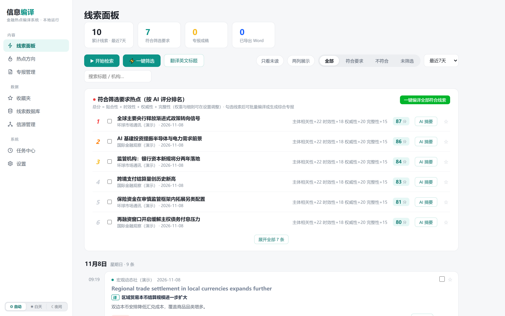

<div align="center">


# FinBrief · 金融热点编译系统

**把"每天扫境内外媒体 → 写中文金融专报"的整条流水线，装进一个本地文件夹。**

自动检索境内外机构公开信息 → AI 逐条筛选评分 → 编译成稿 → 人工复核定稿 → 按专报模板导出 Word。
**全流程数据保存在本机**，不依赖任何云端服务。

[下载程序](../../releases) · [功能特性](#功能特性) · [快速开始](#快速开始) · [常见问题](#常见问题) · [源码运行](#方式二源码运行开发者)

    



*初始界面 · 线索面板（图为内置演示数据）*

</div>

---

> 定位：面向个人研究者的"境外金融信息 → 中文专报"自动化工作台。AI 只产出初稿，专报须经人工复核后导出。

## 功能特性

- **并发检索**：内置 RSSHub 服务（可选，随程序启动）+ 公共实例回退，精选信源开箱即用，支持自定义 RSS / 网页 / AI 添加信源
- **AI 筛选与评分**：六条筛选要求逐条判定 + 四维评分（权重可调、细则可附加），检索后可自动执行
- **编译成稿**：单篇编译 / 2-5 条融合综合专报 / 自定义材料（粘贴文本、网页链接、Word、PDF、图片）
- **编辑器**：AI 对话式修改（流式思考过程、撤销/恢复/前后对比）、人工直改、引用校对（原文对照 + AI 全文翻译）
- **脚注体系**：正文角标自动落在标点前，页底脚注完整可溯，同源线索自动去重
- **导出 Word**：按专报模板排版（刊头/期号/单位/署名可自定义），精简格式可选
- **热点方向**：AI 归纳热点趋势，勾选 2-5 条一键融合
- **数据管理**：收藏夹、线索数据库、AI 主题分类、任务中心、运行日志
- **密钥安全**：API Key 经 Windows DPAPI 加密存储于本机数据库，不以明文写入任何配置文件
- **试用额度**：开发者分发的试用密匙可激活 100 万 tokens 统一试用模型（筛选/编译/翻译），与自定义 API 完全独立

## 界面预览

程序为本地 Web 界面（pywebview / WebView2），左侧导航 + 多页签布局，支持白天/夜间/自动三态主题。

## 快速开始

### 方式一：下载预编译包（推荐普通用户）

前往 [Releases](../../releases) 下载最新版 zip（程序 + 内置 RSSHub），**解压到任意目录，双击 `金融热点编译系统.exe` 即可运行**（Windows 10/11 x64）。

- 首次启动自动创建 `data\` 数据目录与「编译报告」导出目录
- 内置 RSSHub 随程序启动（约 6-12 秒就绪），无需安装 Node.js
- 升级版本：下载新 zip 覆盖程序文件即可，`data\` 数据与设置原样保留

### 方式二：源码运行（开发者）

```bash
git clone https://github.com/jhtfly/FinBrief.git
cd FinBrief
python -m venv .venv
.venv\Scripts\pip install -r requirements.txt
.venv\Scripts\python main.py
```

要求：Windows 10/11（DPAPI 加密、WebView2 依赖）、Python 3.11+。未内置 RSSHub 时程序自动改用公共实例。

### 方式三：源码打包

```bash
.venv\Scripts\pyinstaller.exe build.spec --noconfirm --distpath dist --workpath build_tmp
# 产物在 dist\金融热点编译系统\（exe + _internal）
```

## 配置大模型 API

进入「设置 → 大模型 API」，填写 OpenAI 兼容的 Base URL 与 API Key（支持 DeepSeek、通义千问、GLM 等主流服务商）。拿到试用密匙的用户可直接粘贴激活试用额度（100 万 tokens，筛选 / 编译 / 翻译统一使用试用模型）；试用与自定义 API 完全独立、随时互切，也可一键清除自定义配置重新填写。

## 使用手册

### 1. 检索线索

进入「线索面板」，点「开始检索」。境外站点较多，建议开启系统代理软件后再检索。

### 2. AI 筛选

检索完成点「⚡ 一键筛选」，AI 按六条筛选要求逐条判定（结果标在每条线索上）。

### 3. 编译专报

单条线索点行内「编译」，或勾选多条点「一键编译 / ✦ 综合专报」，也可自己提供材料（「专报管理 → 自定义专报」，支持粘贴文本 / 网页链接 / Word / PDF / 图片）。成稿后进入编辑器人工复核，标题/正文/引用均可改，每一步自动存稿。

### 4. 导出 Word

编辑器内点「编辑完成，导出 Word」，按模板自动排版（默认导出到程序目录下的「编译报告」文件夹，可在设置自定义路径；期号自动连续编号；文件名＝刊头名称+期号+标题，刊头 / 单位 / 署名默认 XXXX 占位，可在设置的「导出排版」修改；可在设置切换「精简格式」，不占期号、无刊头与分隔线，文件名＝导出日期+标题，重复导出自动加"副本"）。

## 模块速览

| 模块 | 说明 |
|---|---|
| 线索面板 | 并发检索（站数可调）、一键筛选、标题自动翻译、检索后自动执行（AI 筛选 / 补全日期 / 标题翻译，均可在设置开关）、只看未读、收藏等 |
| 热点方向 | AI 基于符合要求的线索归纳热点方向（排名/趋势/热度），全部方向直接展示；相关线索可多选（2-5 条）一键融合综合专报 |
| 专报管理 | 单篇 / 综合 / 自定义专报三页签；编辑 / AI 对话式修改（可撤销重做、前后对比可拖动）/ 引用校对 / 导出；默认按添加顺序展示，可切换倒序/修改时间/期号/标题排序，支持标题/机构/期号检索 |
| 收藏夹 | 线索/专报收藏统一管理（含综合/自定义专报收藏），可随时编译核对 |
| 线索数据库 | 全量线索检索与 AI 智能主题分类（胶囊标签可拖动排序，点击查看全部线索），支持单条/批量删除（已编译的拦截提示） |
| 信源管理 | 精选（按分类筛选与聚簇）/ 全部 / 自定义三页签；每源可右键测试与查看详情；AI 自动添加站点；RSSHub 路由库（粘贴链接一键试连添加、路由目录挑路由、自动中文名） |
| 任务中心 | 全部后台任务状态、任务历史「详情」一键直达（含失败明细）、运行日志 |
| 专报共享 | 单选/多选专报一键共享 Word 与文字稿给圈内好友；共享窗口可检索好友共享、下载 Word、查看全文（详见下方「专报共享」章节） |
| 设置 | 大模型 API（试用密匙激活 / 停用、统一试用模型切换、自定义 API 配置与一键清除）、网络与采集、检索后自动化（三开关均默认开）、评分权重、提示词、导出排版、界面外观、专报共享、开源声明 |

## 专报共享

把编译好的专报分享给同事/好友：**Word 文件走接口盒子（apihz.cn）的轻量网盘，共享记录集中在网盘的共享索引里**——所有记录/文件都归开发者账号存储，圈内以「分享用户名」辨认上传者。

**原理（两块）**：
1. 轻量网盘：存放各专报的 Word 文件与一份共享索引（`share_index_v2.json`，含标题/期号/上传者/直链/说明/文字稿）；
2. 共享圈：好友共用同一开发者 ID/KEY，每人在「设置 → 专报共享」里填一个自己的分享用户名，检索时按用户名/标题/期号过滤。

**怎么用**：
- **上传共享**：专报管理点「⇪ 专报共享」（或专报编辑器点「⇪ 分享」快捷上传文字稿）→ 勾选专报（弹窗内可按标题/期号快速检索、全选）→ 填一句说明 → 上传（未导出的会自动先导出；批量串行、每份约 7 秒防限频）。
- **检索拉取**：共享窗口「🔍 检索共享」页签 → 选好友（或全部成员）→ 检索 → 对好友的记录可「⤓ 下载 Word」（存到 `编译报告\共享\`）或「📄 查看全文」（快捷分享的文字稿）；自己的记录可删除（连带删网盘文件）。
- **好友接入**：把开发者 ID 与通讯 KEY 分发给好友，好友在「设置 → 专报共享」填入（或点「一键采用默认 ID/KEY」），各自填一个分享用户名即可互见。

**用户名与好友列表是怎么认人的**：共享没有账号系统——每个人的分享用户名（`share_uid`）只是随共享记录一起写在网盘索引里的"署名"。
- 你上传的每条记录都带上你的 `share_uid`（+ 可选显示名）；检索列表里按它标注「我 / 好友」。
- 「好友列表」纯粹是本机的**检索快捷方式**：把常联系的人（昵称,用户名）记下来，共享窗口的下拉里就能直接按人筛选，不填也能用"全部成员 + 关键词"检索。
- 换句话说：用户名靠**约定辨认**（圈内各自用不同的名字），没有任何密码或验证——所以起名时避免和圈内其他人重名即可。

**注意**：
- 新上传文件的直链有约 1-2 分钟 CDN 刷新延迟，期间下载会提示稍后重试；
- 网盘直链是公开地址（知道链接即可下载），但链接只保存在共享索引里、索引仅对持 ID/KEY 的圈内成员开放；
- 免费额度：apihz 免费档约 10 次/分钟（批量上传已内置限速），网盘 100MB 空间。

## 常见问题

- **多站点失败** → 开启外置代理软件后重新检索。
- **API 429 / 空正文** → 程序已自动重试（次数可调）；仍失败稍后再试或更换模型/服务商。
- **激活了试用密匙仍提示未配置 API** → 确认试用卡处于「已激活」状态（试用模式与自定义 API 相互独立，激活期间无需填写任何 API 地址或密钥）。
- **试用额度用尽** → 向开发者索取新密匙，在设置粘贴激活即可重置；也可「✕ 停用试用」改配自己的 API Key。
- **再次编译同一线索** → 会提示已编译过；确认后旧草稿（含已导出的）将被新草稿替换。
- **AI 添加信源验证未通过** → 源已保存但停用并注明原因；强防护站点可开代理重试。
- **导出被占用** → 关闭正在查看该文件的 Word/WPS 后重试。
- **手改 settings.json** → 需重启程序生效；文件为分区结构，键名请勿改写。

## 数据与隐私

全部数据保存在本机（data 目录）。API Key 经 Windows 加密（DPAPI）存储在本机数据库中，**不以明文写入任何配置文件**，仅用于调用您配置的大模型接口；您自己的密钥绝不外发。程序输出为信息聚合与研究参考，不构成投资建议；专报发布前请人工复核定稿。

技术架构、数据库表、API 一览与更新日志见 [docs/DEVELOPMENT.md](docs/DEVELOPMENT.md)。

## 开源声明与使用须知

- **开源与致谢**：本项目基于开源成果构建——内置 RSSHub 服务基于开源项目 [RSSHub](https://github.com/DIYgod/RSSHub)（MIT License），其余依赖亦为开源社区成果，一并致谢。
- **用途约束**：本程序所采集的各渠道公开信息仅限用于个人学习与研究，请勿将采集结果或本程序用于任何商业用途；由 AI 参与整理生成的专报遵循原文与提示词生成，仅供研究参考，其内容不代表本开源项目或开发者的立场与观点。
- **合规提示**：请遵守目标网站的服务条款与所在地区相关法律法规；请自行配置网络访问条件并承担相关网络使用责任。
- **默认效力**：继续使用本程序即视为已阅读并同意上述全部条款。若不接受，请停止使用并删除程序及其数据文件。

## License

[MIT](LICENSE)
